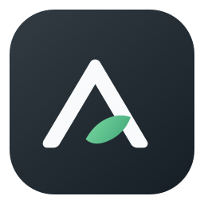

# Aion

[](COVERAGE.md)
[](LICENSE)

A personal finance app for the desktop.
Built with Qt 6 Widgets and SQLite.

- [Test coverage](COVERAGE.md): which files are covered by tests
- [Roadmap](ROADMAP.md): what's planned

Every push is built and tested for Linux and Windows on a CI runner dedicated to Aion and run by me (its
maintainer), so the builds don't use Codeberg's CI resources. How it works:
[Builds and releases](CONTRIBUTING.md#builds-and-releases).

Aion tries to follow the ideas of [permacomputing](https://permacomputing.net/): use as little
computing, energy and storage as the job needs, do work only when it's needed, and keep things
small, simple and long-lived. Feel free to suggest anything related to that.

## Building

Needs Qt 6.5 or newer and CMake 3.19 or newer (newer Qt versions ask for more: Qt 6.12 needs 3.25). Open `CMakeLists.txt` in Qt Creator, or:

```
cmake -S . -B build -DCMAKE_PREFIX_PATH=<path to Qt>
cmake --build build
ctest --test-dir build
```

To set up your development environment (CLion or Qt Creator) and to pick a compiler that matches your Qt kit see [CONTRIBUTING.md](CONTRIBUTING.md).

The coverage report is measured nightly by CI. To measure it yourself (GCC or Clang, with
[gcovr](https://gcovr.com)):

```
cmake -S . -B build-coverage -DCMAKE_BUILD_TYPE=Debug -DAION_COVERAGE=ON -DCMAKE_PREFIX_PATH=<path to Qt>
cmake --build build-coverage
scripts/coverage.sh build-coverage
```

`--publish` also rewrites `COVERAGE.md` and the badge.

## License

Copyright © 2024–2026 the Aion contributors (see [AUTHORS](AUTHORS)).

Aion is free software: you can redistribute it and/or modify it under the terms of the GNU General
Public License as published by the Free Software Foundation, either version 3 of the License, or (at
your option) any later version. It is distributed in the hope that it will be useful, but WITHOUT ANY
WARRANTY; see [LICENSE](LICENSE) for details.

This covers the source code and every asset made for Aion, except its name and logo.

**Name and logo.** The name "Aion" and the Aion logo (`assets/aion-logo.svg` and the icons made from
it) are not covered by the GPL; all rights reserved by the Aion contributors. You may use them to refer
to Aion, for example in articles or links. Modified versions that get distributed need their own name and
logo.

**Third-party parts** keep their own licenses:

| What | License |
|---|---|
| Interface icons in `assets/icons/`, based on [Tabler Icons](https://tabler.io/icons) | MIT, see [assets/icons/LICENSE](assets/icons/LICENSE) |
| [Qt](https://www.qt.io) (used, not included) | LGPL-3.0 or a commercial license |
| [SQLite](https://sqlite.org) (used through Qt, not included) | Public domain |
